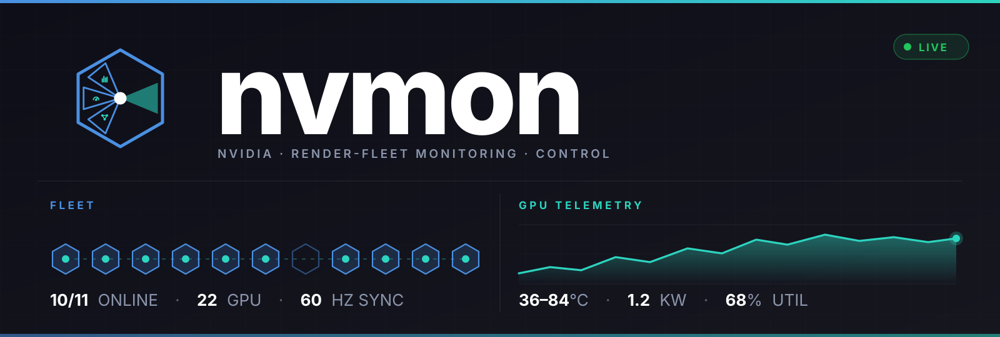
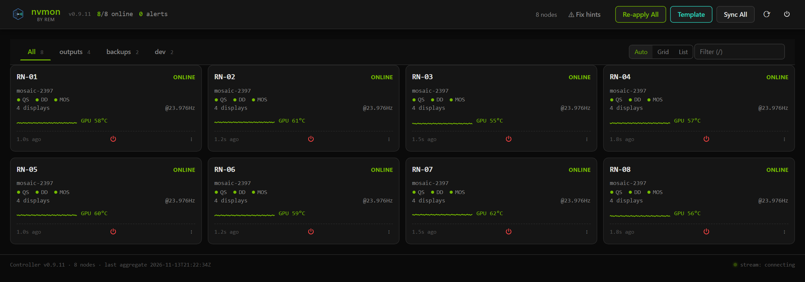
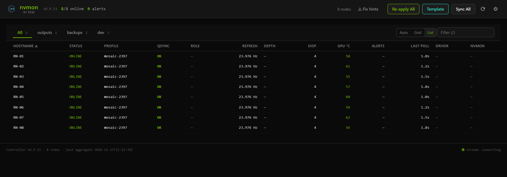
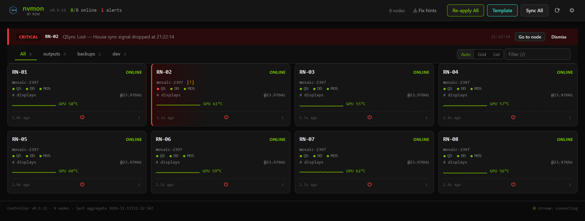
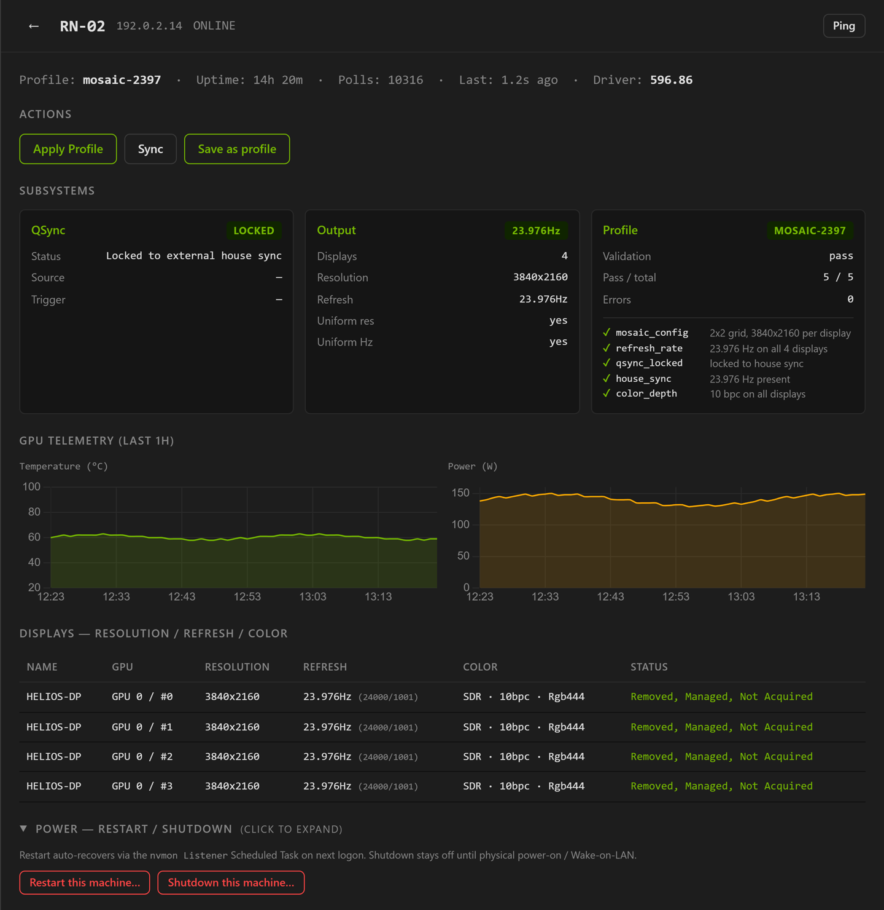
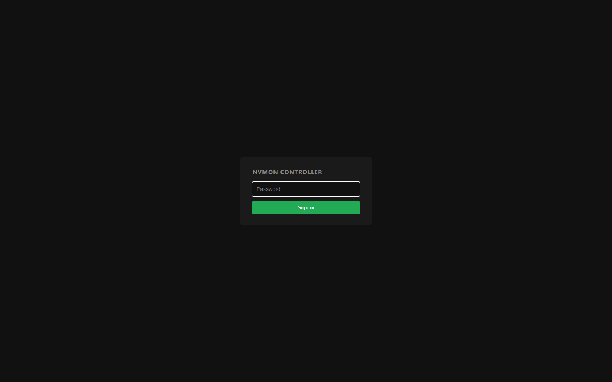

<p align="center">
  
</p>

# nvmon

Monitoring and control daemon for NVIDIA Windows render nodes.

`nvmon` is a standalone product that provides a unified monitoring + fan-out
control experience across multiple NVIDIA-equipped servers. It covers
DirectDisplay, Mosaic, QSync, GPU telemetry, EDID, profile load/apply, and
validation — exposed over HTTP, usable from a browser or from scripts.

## Dashboard

Every render node shows up as a card on the controller's dashboard at
`:9997`. Live status, GPU temps, sync state, validation pass/fail, and
per-node action menus all hang off the same view. Fan-out actions across
the entire fleet (Re-apply All, Template, Sync All, and the power menu) sit
in the header.









<sub>Screenshots show the built-in demo fleet (`nvmon/controller/dashboard_unified/fixtures/mock_status.json`), not a live site.</sub>

The controller is the only authenticated surface — one shared password in
`secrets/controller.password`. Browsers get the login form below; API
clients send the password in the `X-NVMON-Password` header.



## Two roles

The repo splits into a **listener** (per render node: agent + launcher) and a
**monitor** (central: controller + unified dashboard). One unified installer
(`bats\install.bat`) handles both roles via `--listener` / `--monitor` /
`--both`. Each role has its own everyday run/kill bat at the project root.
Python ships in `python\` after the first install, so a fresh node is just
"copy the folder and double-click".

| Side | Install | Run | Stop | Ports |
|------|---------|-----|------|-------|
| Listener (every render node) | `bats\install.bat --listener` | `run_listener.bat` | `kill_listener.bat` | 9998 (agent), 9996 (launcher) |
| Monitor (one central box) | `bats\install.bat --monitor` | `run_monitor.bat` | `kill_monitor.bat` | 9997 (controller) |

The installer must be Run as Administrator. The `run_*.bat` scripts
self-bootstrap — if the enclosed Python isn't there yet, they fire
`bats\install.bat` once via UAC and then continue. After that first install,
the monitor side runs **without any UAC prompt** (the controller doesn't
need admin); the listener side runs elevated via a per-user Scheduled Task
that also skips the prompt.

## Install

### On every render node
```cmd
bats\install.bat --listener
```
Bootstraps Python, installs deps, copies NVIDIA CLI tools, opens firewall
ports 9998 + 9996 + 5353, and registers a per-user Scheduled Task **"nvmon
Listener"** that runs `run_listener.bat` elevated at every logon — no UAC.

### On the monitor box
```cmd
bats\install.bat --monitor
```
Same Python bootstrap, prompts for the controller password, opens firewall
port 9997, and drops an **"nvmon Monitor"** shortcut on the Public Desktop.

### On a single host that does both
```cmd
bats\install.bat            :: same as --both
```

Then copy `nvmon.toml.example` to `nvmon.toml` and edit it (see
[Configure the fleet](#configure-the-fleet) below).

## Run

```cmd
run_listener.bat   :: agent + launcher, elevated (per render node)
run_monitor.bat    :: controller in a minimized console, opens browser, adds itself to Startup (monitor box)
```

Closing the monitor terminal stops the controller. `kill_*.bat` is the
safety-net stop.

## Configure the fleet

`nvmon.toml` lives at the project root and is **per-machine** — it is
never mirrored across the fleet. Copy the template:

```cmd
copy nvmon.toml.example nvmon.toml
```

Then open `nvmon.toml` and add an entry under `[[controller.nodes]]` for
every agent the monitor should poll. **The hostname must match what the
node's `socket.gethostname()` returns** (case-insensitive comparison, but
match exactly to keep the dashboard readable):

```toml
[[controller.nodes]]
hostname = "RENDER-NODE-01"
url      = "http://10.0.0.11:9998"

[[controller.nodes]]
hostname = "RENDER-NODE-02"
url      = "http://10.0.0.12:9998"
```

Static config entries always win over mDNS auto-discovery — they appear
whether the multicast packet survived the LAN or not. Leave the section
empty if you want mDNS-only discovery.

Big fleet? Skip the per-node blocks and give the controller an IP list —
it learns each node's hostname from the agent on the first poll:

```toml
[controller]
node_ips = ["10.0.0.11", "10.0.0.12", "10.0.0.13"]
```

Two other knobs in the same file are worth knowing about:

- **`apply_excluded_hosts`** — case-insensitive list of leading DNS labels
  that the controller will skip during a fleet `Apply Profile` fan-out.
  Sync / Restore / Restart still hit them. Use this for the one node that
  has its own profile (e.g. a 1080p box in an otherwise 4K fleet) until
  you save it its own preset.
- **`[network].announce_ip`** — pin the IP that this box advertises (via
  mDNS, push-register, and `/health`). Required on multi-NIC boxes where
  the auto-detect picks the office NIC instead of the render-subnet NIC.
  Leave blank to use auto-detect.

The zero-touch alternative is `monitor.url`: a single-line file at the
project root that tells each listener which controller to push-register
with on boot. Mirror that one file across the fleet and every node finds
the monitor without any TOML editing.

## Push a preset to every node

```cmd
bats\sync_presets.bat mosaic-2397            :: apply to all
bats\sync_presets.bat --restore              :: every node back to desktop
bats\sync_presets.bat --group outputs mosaic-24
bats\sync_presets.bat --list                 :: show node list
```

This wraps the controller's `/all/apply` fan-out — the controller must be
running on this box. It reads `secrets\controller.password` (empty file =
no-auth mode) and sends the password via the `X-NVMON-Password` header.

## Redeploy after a code change

Edited a `nvmon\*.py` file on this box and want to reload it without
re-copying the whole tree? Use the redeploy helper:

```cmd
bats\redeploy.bat listener   :: stop listener + wipe __pycache__ + restart
bats\redeploy.bat monitor    :: same for the controller
bats\redeploy.bat verify     :: print the on-disk version (no restart)
```

Python's bytecode cache is sticky enough to hide the removal of an
import; `redeploy.bat` wipes `nvmon\**\__pycache__` so the next boot
re-imports from source.

## Profile persistence across reboots

Apply a profile once from the dashboard (or `sync_presets.bat`) and every
listener writes a self-contained snapshot at `active_profile.json` next
to the project root. The snapshot bundles the full profile dict **and**
any referenced EDID bytes inline — so on the next reboot, the listener
applies it locally without needing the monitor to be reachable, the
`profiles/` directory to be in sync, or the `Edids/` directory to exist
on disk. The boot-apply is **idempotent**: if the live state already
matches, nothing is re-run. Only validator drift triggers a re-apply.

A `/restore` from the dashboard deletes the snapshot, so a restored node
boots clean and stays at the desktop.

```
POST /apply  {profile: "X"}   →  active_profile.json written  →  next boot self-heals
POST /restore                 →  active_profile.json deleted  →  next boot stays desktop
```

No per-node `nvmon.toml` editing. No "set apply_on_boot before deploy".
The most recent operator click IS the boot contract.

## Direct CLI

If you want to bypass the bats:

```cmd
python\python.exe -m nvmon agent           :: HTTP :9998
python\python.exe -m nvmon controller      :: HTTP :9997
python\python.exe -m nvmon launcher        :: HTTP :9996
python\python.exe -m nvmon discover        :: mDNS browse
python\python.exe -m nvmon save-profile <name> [--description "..."]
python\python.exe -m nvmon version
```

## All the batch scripts

The repo root contains only the four scripts you'll touch every day.
Everything else lives in `bats\` because it's run rarely (or never
manually — `_restart_listener_helper.bat` is detached-spawned by the
agent).

| Bat                                | Where        | When you use it |
|------------------------------------|--------------|------------------|
| `run_listener.bat`                 | root         | Daily — start the listener (agent + launcher) on a render node |
| `kill_listener.bat`                | root         | Daily — stop the listener |
| `run_monitor.bat`                  | root         | Daily — start the controller + dashboard on the monitor box |
| `kill_monitor.bat`                 | root         | Daily — stop the controller |
| `bats\install.bat`                 | bats\        | Once per machine, as Administrator — first-time bootstrap. Idempotent: rerun to repair, add the other role, or rotate the controller password |
| `bats\redeploy.bat`                | bats\        | After editing `nvmon\*.py` on a deployed box — stop, wipe `__pycache__`, restart |
| `bats\sync_presets.bat`            | bats\        | Push a preset to every node via the controller's fan-out endpoints |
| `bats\remove_startup.bat`          | bats\        | One-off: disable the listener's auto-start at logon (creates `.no_autostart` sentinel). Rerun `bats\install.bat --listener` to re-enable |
| `bats\_restart_listener_helper.bat`| bats\        | **Don't invoke directly.** Spawned detached by the agent's `restart_listener` endpoint — bounces the listener without taking down the agent's HTTP response |

## Repo layout

```
NVMON\
├── nvmon\                  Python package (agent / controller / launcher)
├── python\                 Enclosed embedded Python (created by install)
├── bin\                    NVIDIA CLI utilities (bundled; NVIDIA licence)
├── profiles\               Editable profile library (one *.json per preset)
├── Edids\                  Operator-dropped EDID overrides (.txt / .bin / .dat)
├── secrets\                Password file (owner-only ACL)
├── logs\                   Daily log files + install logs
├── tests\                  Unit + smoke tests
├── docs\                   Specs and architecture notes
├── bats\                   Secondary bats (install, redeploy, sync, etc.)
├── run_listener.bat        Start listener (agent + launcher)
├── kill_listener.bat       Stop listener
├── run_monitor.bat         Start controller (minimized console; per-user Startup shortcut)
├── kill_monitor.bat        Stop controller
├── active_profile.json     Boot-apply contract — written by /apply, deleted
│                           by /restore. Self-contained (profile dict + EDID
│                           bytes inlined). Per-node, never sync this file.
├── status.json             Current telemetry snapshot (per-node, per-tick).
├── monitor.url             Optional one-line file telling the listener which
│                           controller to push-register with on boot.
├── nvmon.toml              Per-node config (NOT mirrored across the fleet).
├── nvmon.toml.example      Config template — copy to nvmon.toml and edit.
├── requirements.txt
├── pyproject.toml
└── README.md
```

`active_profile.json`, `status.json`, `nvmon.toml`, and the `logs/` and
`secrets/` directories are per-node state and **must be excluded from any
cross-node mirror** (FreeFileSync etc.). Mirroring them would overwrite
each node's local state on every sync — defeating the whole point of the
boot-apply snapshot. Mirror only the source tree (`nvmon\`, `bin\`,
`profiles\`, `Edids\`, `python\`, `bats\`, the root `*.bat` files, and
`monitor.url`).
