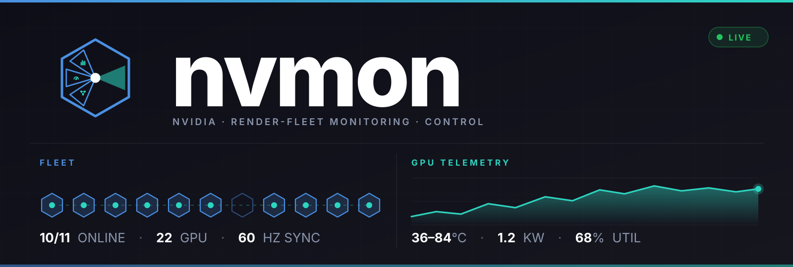
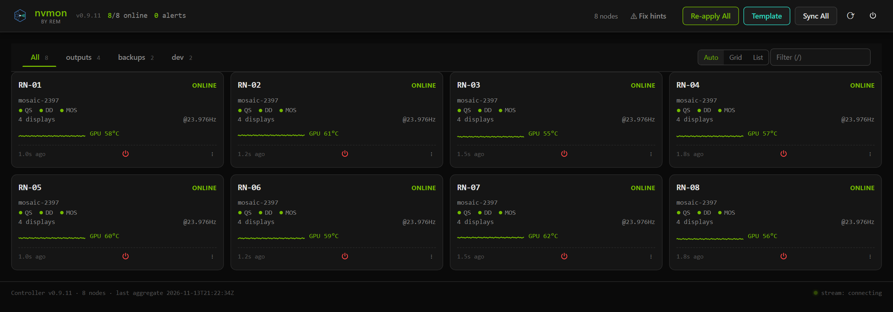
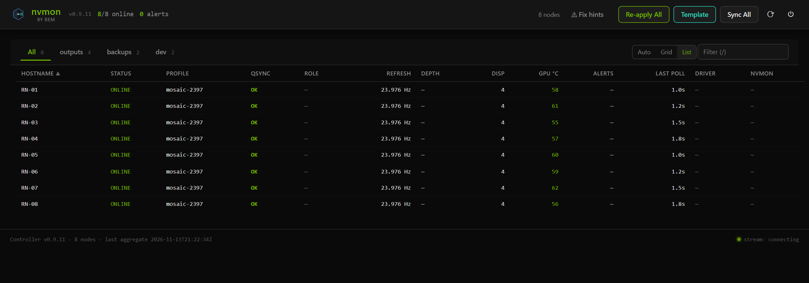
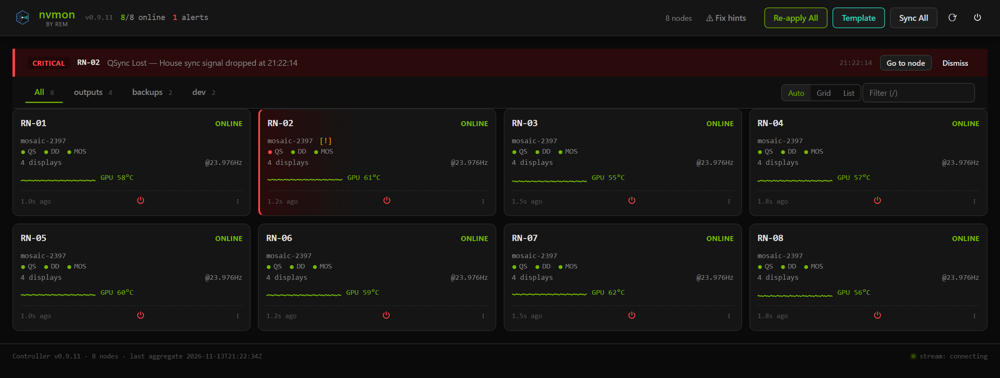
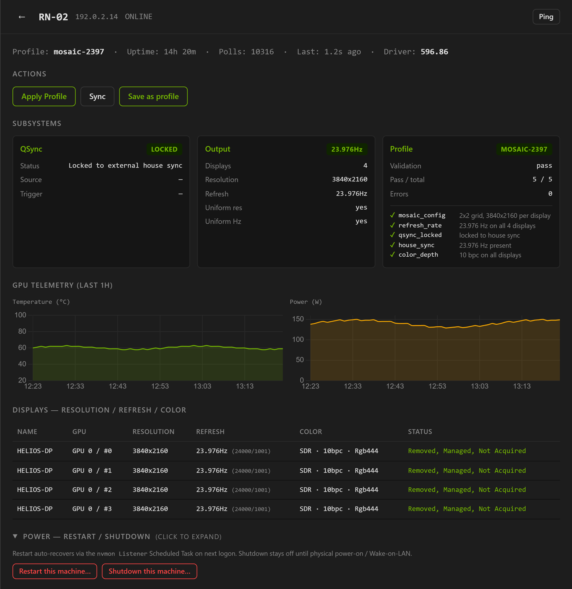
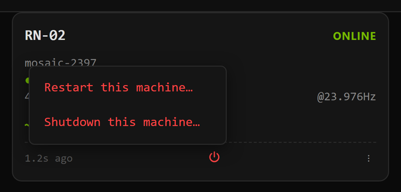

<p align="center">
  
</p>

# nvmon

**One dashboard for every NVIDIA render node you run.** See the whole fleet at a
glance: Quadro Sync lock, Mosaic, Direct Display, refresh rate and GPU
temperature on every machine. Push the same setup to all of them with one click.

nvmon is free and open source (MIT) and runs on Windows. It's built for LED
walls, projection rigs, media servers and render farms on NVIDIA RTX PRO /
Quadro cards.

---

## What you get

**The whole fleet on one page.** Every render node is a card showing its
profile, sync state (QS), Direct Display (DD), Mosaic (MOS), refresh rate and
GPU temperature.



**Or as a list,** when you have a lot of nodes:



**Problems jump out.** When a node loses Quadro Sync, its card turns red and an
alert names the node:



**Click any node for everything about it:** sync lock, outputs, profile
checks, GPU history, every display, and restart / shutdown buttons.

<p>
  
  
</p>

**Fleet-wide buttons** in the header:

- **Re-apply All:** every node re-applies its own saved display profile.
- **Template:** switch the whole fleet to another profile set.
- **Sync All:** re-lock Quadro Sync everywhere.
- **Power menu:** restart or shut down machines.

**A mini monitor for your desktop.** The desktop app shrinks the dashboard into
a small always-on-top ring. The ring shows nodes online, the fleet's refresh rate
and colour depth. It's green when everything is in sync. Click it to open the
full dashboard.

<sub>Screenshots use nvmon's built-in demo fleet (RN-01 to RN-08), not a live site.</sub>

---

## How it fits together

There are two kinds of machine:

| Machine | What runs there | How many |
|---|---|---|
| **Render node** | the **listener**: talks to the GPU and the NVIDIA tools | one per render machine |
| **Monitor box** | the **monitor**: the dashboard you open in a browser | one for the whole fleet (can be any PC on the network) |

The monitor finds the render nodes automatically on the local network. You can
also list them by IP in `NVMON\nvmon.toml`.

---

## Install

You need Windows 10/11, the NVIDIA driver, and internet access the first time
(the installer downloads its own private copy of Python and touches nothing
else on the system). Everything nvmon needs is in the `NVMON\` folder,
**including the NVIDIA tools**. There's nothing extra to download.

**1. Copy the `NVMON` folder** to each machine (git clone, USB stick or network
share).

**2. On each render node,** right-click → *Run as administrator*:

```cmd
NVMON\bats\install.bat --listener
```

It sets up Python, opens the firewall ports and adds a startup task, so the
listener runs at every logon.

**3. On the monitor box,** right-click → *Run as administrator*:

```cmd
NVMON\bats\install.bat --monitor
```

It asks for a dashboard password (leave it empty for no password) and puts an
**nvmon Monitor** shortcut on the desktop.

**4. Run it:**

```cmd
NVMON\run_listener.bat      :: on each render node (starts by itself after install)
NVMON\run_monitor.bat       :: on the monitor box; opens the dashboard
```

The dashboard is at `http://<monitor-box>:9997`. To stop them, use
`kill_listener.bat` / `kill_monitor.bat`.

Re-running `install.bat` is safe. Use it to repair an install or change the
password.

### Desktop app and mini monitor (optional)

On any Windows PC on the same network:

```cmd
NVMON\nvmon_app.bat
```

This opens the dashboard in its own window. Its ◉ button shrinks it into the
mini monitor ring. The app starts with Windows (toggle it in the ring's
right-click menu). No admin rights needed.

### Updating an existing install

From a newer copy of nvmon (for example a fresh clone), point at the installed
folder:

```cmd
NVMON\update_site.bat E:\NVMON --dry-run   :: shows what would change
NVMON\update_site.bat E:\NVMON             :: does it, asking before each step
```

It updates the code only. Your settings, passwords, profiles, EDIDs and logs
are never touched, and every replaced file is backed up first.

More detail: [`NVMON/README.md`](NVMON/README.md) (settings, presets, every
script) and [`NVMON/docs/DEPLOYMENT.md`](NVMON/docs/DEPLOYMENT.md) (full
install guide).

---

## Bundled NVIDIA tools

nvmon drives three NVIDIA command-line utilities, which ship in `NVMON\bin\`:

| File | What it controls | Version | SHA-256 |
|---|---|---|---|
| `configureMosaic.exe` | Mosaic (the version nvmon runs) | 2.4.9 | `9701e401f5a6535b599ae7538e3754394930661416dde844cf22737ed073220c` |
| `configureMosaic-2.5.3.exe` | Mosaic, newer version (optional, see DEPLOYMENT.md) | 2.5.3 | `ec2609399c9aa68c4ee14017a94552b8f8fa40e8a3f20240d535c4d1a2d93f68` |
| `configureDdisplay.exe` | Direct Display | 1.8.3405.878 | `b73920f75509fd7acbeb7367b5021e128033ef3fafbd6c69c41a5d88cf91805c` |
| `configureQsync2.exe` | Quadro Sync | 2.1.3339.3914 | `b220ec180d30ca9a238509e95965f7c60a2dee45c2349c474000d703d3168ce4` |

The prebuilt desktop-app window is bundled too:

| File | SHA-256 |
|---|---|
| `NVMON\bin\nvmon-window\nvmon-window.exe` | `0a9ece65404cdb15f6f23b972e9af57f5d42e00e4a923d9187fc21641b4e77db` |

To check a file, run `certutil -hashfile <file> SHA256`. If a tool goes
missing, nvmon keeps running: that feature just shows as unavailable, and the
installer tells you which file is missing.

---

## For developers

**The parts and their ports:**

| Part | Port | Login | Runs on |
|---|---|---|---|
| `agent` | 9998 | none (trusted network) | each render node |
| `launcher` | 9996 | none | each render node (optional) |
| `controller` | 9997 | one shared password | the monitor box |

- **The agent** talks to the hardware through `nvidia-smi` and the NVIDIA tools
  above.
- **The launcher** starts and supervises your show apps alongside nvmon.
- **The listener** runs the agent and launcher together.
- **The controller** polls every agent, serves the dashboard and sends commands
  to the whole fleet.

Design docs are in [`NVMON/docs/`](NVMON/docs/).

**Tests:**

```cmd
cd NVMON
python\python.exe -m pytest tests/unit      :: unit tests
python\python.exe -m pytest                 :: everything (smoke tests need a running controller)
```

**Security model.** nvmon assumes a private render network, not the internet.
The agent and launcher have no login. The dashboard has one shared password,
kept in `NVMON\secrets\controller.password`; scripts send it in the
`X-NVMON-Password` header. There's no TLS and there are no per-user accounts.

---

## License

nvmon is released under the [MIT License](LICENSE). Bundled third-party parts
keep their own licences:

- **NVIDIA tools** in `NVMON/bin/`: NVIDIA software under NVIDIA's own licence
  terms (not MIT).
- **WebView2** DLLs in `NVMON/bin/nvmon-window/`: Microsoft, under
  `WebView2-LICENSE.txt`.
- **htmx, Alpine.js, Chart.js** in
  `NVMON/nvmon/controller/dashboard_unified/static/vendor/`: their own
  projects' licences.
- **Python** and its packages, downloaded by the installer: their own
  licences.
